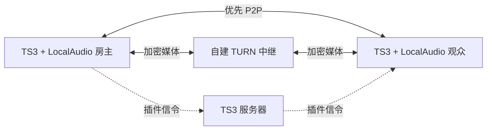

<p align="center">
  
</p>

<p align="center">
  <strong>让 LocalAudio 屏幕共享在直连困难时，拥有一条可自行部署的中继路径。</strong><br>
  TeamSpeak 3 · WebRTC · coturn · Debian / Docker<br>
  <sub>Design by ningq</sub>
</p>

<p align="center">
  <a href="https://github.com/NingQ197/LocalAudio-NingQ/actions/workflows/ci.yaml"></a>
  &nbsp; <a href="#快速部署">快速部署</a>
  &nbsp;·&nbsp; <a href="docs/DEPLOYMENT.md">部署详解</a>
  &nbsp;·&nbsp; <a href="docs/TROUBLESHOOTING.md">故障排查</a>
  &nbsp;·&nbsp; <a href="docs/AUDIT.md">审查记录</a>
</p>

## 项目定位

LocalAudio-NingQ 是面向 **TeamSpeak 3 + LocalAudio 客户端**的屏幕共享 TURN 中继服务端。它来自原版免激活服务端的可读源码，适合在自己的 Debian 服务器上通过 Docker 构建和运行。

| 项目 | 行为 |
| --- | --- |
| 购买激活 | 无需激活码，无在线许可证验证 |
| 访问鉴权 | 强制 TURN 用户名、密码；默认使用永久静态账号 |
| 连接方式 | 客户端优先 P2P，可回退或强制使用 TURN 中继 |
| 默认入口 | `21113/UDP`、`21113/TCP` |
| 中继端口 | 默认 `49160–49200/UDP`，与入口端口一起放行 |
| 可选 TLS | 通过独立 Compose 覆盖文件启用 |
| 运行约束 | 非 root、只读文件系统、能力收缩、日志轮转及分配配额 |
| 媒体 | 转发 WebRTC 加密的屏幕画面与附带音轨 |

**“免激活”与“匿名中继”是两回事。** 本项目保留 TURN 鉴权，使用者需要获得你设置的账号和密码。源码采用明文脚本便于审查，WebRTC 媒体仍采用其正常的 DTLS-SRTP 加密。

屏幕采集、画质、帧率和观看界面由客户端提供；普通 TS 语音与音乐转播也由客户端及 TS 服务承担。本仓库聚焦中继部署。

## 快速部署

适用环境：Debian x86_64、Docker Engine、Docker Compose v2、OpenSSL。按需安装上述组件后：

```sh
git clone https://github.com/NingQ197/LocalAudio-NingQ.git
cd LocalAudio-NingQ
cp .env.example .env
nano .env
```

填写自己的 `TURN_REALM` 和 `TURN_PUBLIC_IP`，然后运行：

```sh
sudo sh scripts/deploy.sh
```

脚本会构建镜像、生成本地随机密码、检查配置并启动服务。再次部署会保留已有密码；变更配置后重新创建中继容器会中断现有中继连接。

密码保存在 **`secrets/turn-password`**。请通过安全方式同步给允许使用中继的客户端；它不会出现在仓库模板或正常部署输出中。

防火墙和云安全组需允许：

| 用途 | 默认端口 |
| --- | --- |
| STUN / TURN 客户端入口 | `21113/UDP`、`21113/TCP` |
| TURN 媒体中继范围 | `49160–49200/UDP` |
| 可选 TURN over TLS | 配置的 TLS 公网 TCP 端口 |

只开放 `21113` 不足以覆盖本部署方式的全部中继流量。自定义端口后，Compose 映射与防火墙规则需要同步。

## 客户端填写

在 LocalAudio 的网络设置中，使用自己部署的地址和静态账号：

```text
STUN:  stun:relay.example.com:21113
TURN:  turn:relay.example.com:21113?transport=udp
       turn:relay.example.com:21113?transport=tcp
用户名: .env 中的 TURN_USERNAME
密码:   本地 secrets/turn-password 的内容
```

`relay.example.com` 是说明用域名。请替换成自己的中继域名；示例配置没有内置任何运营者的服务器或共享密码。

保持客户端的自动连接策略可优先尝试 P2P；排查中继时使用强制 TURN，并在连接状态中确认候选类型为 `relay`。

## 连接关系



## 常用操作

```sh
docker compose ps
docker compose logs --tail 50 turn
docker compose run --rm --no-deps turn --validate-only
docker compose down
```

`--validate-only` 检查入口脚本接收的配置；健康检查只验证 STUN 响应。完整连通性还需要客户端强制中继的实际音画验证。

## 文档导航

| 文档 | 内容 |
| --- | --- |
| [部署详解](docs/DEPLOYMENT.md) | 参数、TLS、密码文件、备份和升级 |
| [故障排查](docs/TROUBLESHOOTING.md) | 486 配额、鉴权失败、端口和 NAT |
| [安全说明](SECURITY.md) | 信任边界、运行文件与问题报告 |
| [审查记录](docs/AUDIT.md) | 本次代码整理、修复及验证范围 |
| [第三方声明](server/THIRD_PARTY_NOTICES.txt) | coturn 与 Debian 组件来源 |

## 目录

```text
server/                 中继镜像与可读入口源码
scripts/deploy.sh       构建和部署入口
tests/                  配置测试与真实容器协议测试
tools/check_publish.py  上传边界与敏感内容检查
docs/                   部署、排错、审查和首页资源
compose.yaml            默认 UDP/TCP 部署
compose.tls.yaml        可选 TLS 端口覆盖
.env.example            只有占位符的配置模板
```

## 验证与来源

CI 会运行源码发布边界检查、Shell 语法检查、配置负例测试、Compose 校验、Docker 构建，以及真实容器的 UDP/TCP 鉴权和受限对端测试。测试只使用合成凭据与隔离端点。

```sh
python3 tools/check_publish.py
python3 -m unittest discover -s tests -p 'test_*.py' -v
docker build -t localaudio-ningq:test ./server
LOCAL_AUDIO_TEST_IMAGE=localaudio-ningq:test \
  python3 -m unittest discover -s tests -p 'test_container.py' -v
```

基础镜像固定到 [coturn 4.18.0 的官方 Debian 镜像](https://github.com/coturn/coturn/tree/docker/4.18.0-r0)摘要。协议与参数可参考 [TURN RFC 8656](https://www.rfc-editor.org/rfc/rfc8656.html) 和 [coturn 配置说明](https://github.com/coturn/coturn/blob/4.18.0/examples/etc/turnserver.conf)。固定摘要便于复现，后续仍需关注上游更新。

项目源码许可证暂未另行指定；第三方组件保留各自的许可证和声明。
