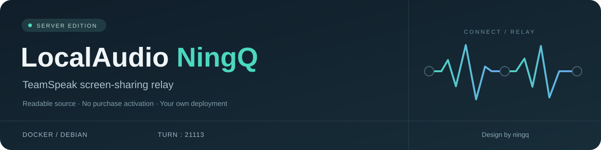

<p align="center">
  
</p>

<p align="center">
  <strong>为 LocalAudio 屏幕共享提供自己的中继服务器。</strong><br>
  TeamSpeak 3 · WebRTC · coturn · Debian / Docker<br>
  <sub>Design by ningq</sub>
</p>

<p align="center">
  <a href="https://github.com/NingQ197/LocalAudio-NingQ/releases/tag/v2.1.0">下载服务端</a>
  &nbsp;·&nbsp; <a href="docs/DEPLOYMENT.md">Linux 部署</a>
  &nbsp;·&nbsp; <a href="docs/TROUBLESHOOTING.md">常见问题</a>
  &nbsp;·&nbsp; <a href="https://github.com/NingQ197/LocalAudio-Plugin">LocalAudio 插件</a>
</p>

## 功能

LocalAudio-NingQ 是 [LocalAudio 插件](https://github.com/NingQ197/LocalAudio-Plugin)的屏幕共享 TURN 中继服务端。客户端优先 P2P 直连；直连困难时，使用服务器转发画面和共享音轨。

- 支持 Debian 等 Linux 系统，使用 Docker 部署。
- 默认入口为 **21113 TCP / UDP**，支持 IPv4、双栈和 IPv6-only 部署。
- 使用永久用户名和密码，首次部署自动生成密码，再次部署保留原账号。
- WebRTC 媒体采用 DTLS-SRTP 加密，可选 TURN TLS。
- 包含连接配额、带宽和容器资源限制。

屏幕选择、分辨率、帧率和观看界面由插件提供。中继账号控制服务器流量使用，观看范围由插件和 TS 频道访问规则决定。屏幕媒体走 WebRTC 连接，独立于 TS 语音流。

## 快速部署

下面使用 **Linux amd64** 离线镜像包。服务器需装好 Docker Engine、Compose v2、OpenSSL、Python 3、unzip 和 nano；详细安装命令见[Linux 部署指南](docs/DEPLOYMENT.md#准备环境)。

### 1. 下载并上传

在本机打开 [v2.1.0 下载页](https://github.com/NingQ197/LocalAudio-NingQ/releases/tag/v2.1.0)，下载这两个附件：

- `LocalAudio-Server.zip`：Docker 镜像、配置、脚本和源码。
- `SHA256SUMS.txt`：安装包校验文件。

使用 SFTP 上传，或在本机终端执行，替换连接信息和目标目录：

```sh
scp LocalAudio-Server.zip SHA256SUMS.txt user@your-server:/home/user/
```

`LocalAudio-Server.zip` 是带镜像的服务端包；GitHub 自动提供的 `Source code (zip)` 只有源码。

### 2. 校验、解压和配置

以下命令在服务器上执行，先进入上传目录：

```sh
sha256sum -c SHA256SUMS.txt &&
unzip -q LocalAudio-Server.zip &&
cd LocalAudio-Server &&
cp .env.example .env &&
nano .env
```

这段命令仅在上一步成功时继续。ZIP 校验显示 `OK`、解压和配置完成后，再执行启动步骤。

默认使用 IPv4，修改这两项：

```text
TURN_REALM=你的中继域名
TURN_PUBLIC_IP=你的服务器公网IPv4
```

域名不带协议或端口，`TURN_PUBLIC_IP` 填实际公网地址。[双栈及 IPv6-only 配置](docs/DEPLOYMENT.md#ipv6)见部署指南。

### 3. 放行端口并启动

云安全组和服务器防火墙同时放行：

| 端口 | 用途 |
| --- | --- |
| `21113/TCP`、`21113/UDP` | STUN / TURN 入口 |
| `49160–49200/UDP` | 媒体中继 |

双栈部署需要同时放行 IPv4 和 IPv6 规则。

```sh
sha256sum -c LocalAudio-Server.tar.gz.sha256 &&
sudo docker load -i LocalAudio-Server.tar.gz &&
sudo sh scripts/deploy.sh --no-build &&
sudo docker compose ps &&
sudo cat secrets/turn-password
```

镜像校验或导入失败时，这段命令会停止，后面的启动不会执行。`--no-build` 使用已导入镜像，服务器无需安装 Git，也无需访问 GitHub。

### 4. 填入插件

在插件的屏幕共享网络设置中填写：

```text
STUN:  stun:relay.example.com:21113
TURN:  turn:relay.example.com:21113?transport=udp
       turn:relay.example.com:21113?transport=tcp
用户名: localaudio
密码:   secrets/turn-password 中的内容
```

将域名替换成自己的中继地址。用户名以 `.env` 中的 `TURN_USERNAME` 为准。日常使用自动模式可优先 P2P；测试中继时选择强制中继，确认连接状态为 `relay` 后检查画面和音轨。

## 从源码构建

需要服务器能够下载 GitHub 源码和镜像构建依赖：

```sh
git clone --branch v2.1.0 --depth 1 https://github.com/NingQ197/LocalAudio-NingQ.git &&
cd LocalAudio-NingQ &&
cp .env.example .env &&
nano .env &&
sudo sh scripts/deploy.sh
```

同样需要填写地址和放行端口。完整流程见[Linux 部署指南](docs/DEPLOYMENT.md)。

## 文档

| 文档 | 内容 |
| --- | --- |
| [Linux 部署](docs/DEPLOYMENT.md) | 离线镜像、源码构建、IPv6、TLS、更新与备份 |
| [常见问题](docs/TROUBLESHOOTING.md) | 486、401、端口、IPv6 和连接问题 |
| [安全机制与验证](docs/AUDIT.md) | 鉴权、网络策略与测试范围 |
| [安全说明](SECURITY.md) | 权限边界与漏洞反馈 |
| [更新记录](CHANGELOG.md) | 版本变化 |

## 开发

```sh
python3 tools/check_publish.py &&
python3 -m unittest discover -s tests -p 'test_*.py' -v &&
docker build -t localaudio-ningq:test ./server &&
LOCAL_AUDIO_TEST_IMAGE=localaudio-ningq:test python3 tools/run_container_checks.py
```

CI 包含配置测试、真实容器鉴权和媒体中继测试，以及最终镜像依赖扫描。容器测试覆盖本地协议路径；云防火墙、运营商网络和客户端公网连接需要在实际部署后验证。

项目使用 [MIT 许可证](LICENSE)。coturn 与 Debian 组件见[第三方声明](server/THIRD_PARTY_NOTICES.txt)。
